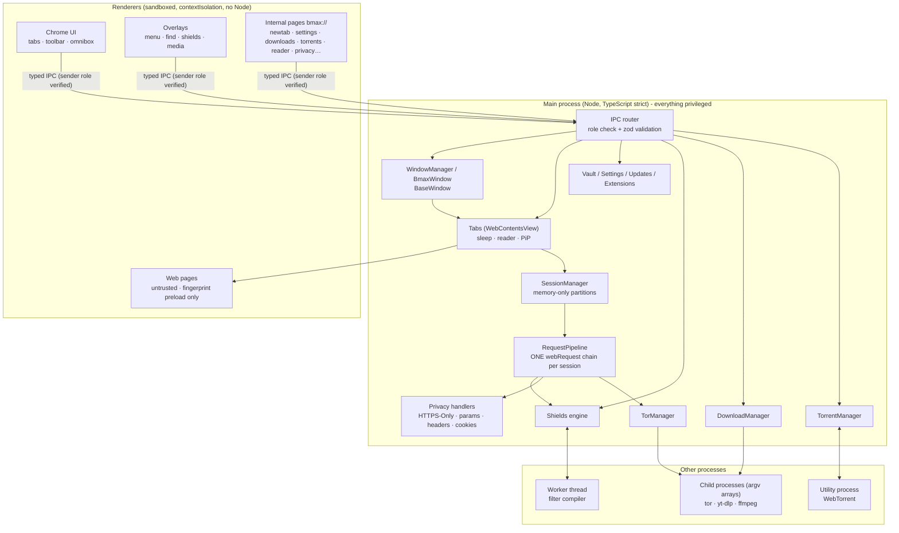

# BMAX Browser

A privacy-first desktop web browser for Windows (primary), macOS and Linux, built on Electron (`BaseWindow` + `WebContentsView`),
TypeScript (strict), React, Vite and Tailwind. No telemetry, no analytics, no accounts.

> **Status:** all six development phases are implemented (see `CLAUDE.md` for the phase log and known gaps). Only the **Windows x64** build has
> been packaged and run during development; macOS/Linux packaging is configured but unverified. There is no published release yet.

## What it does
| Area | Highlights |
|---|---|
| **Browsing** | tabs (pin, mute, reorder, tear-off), omnibox, find, zoom, print, view-source, DevTools, PDF viewer, Chrome-compatible shortcuts, light/dark theme |
| **Privacy by default** | memory-only sessions (nothing browsing-related on disk), container tabs, isolated windows, **Burn** button, HTTPS-Only, third-party cookie blocking, tracking-parameter stripping, referrer trimming, GPC, uniform browser identity, fingerprint noise, WebRTC leak protection, DNS-over-HTTPS |
| **Tor windows** | every request through a bundled Tor, fail-closed until bootstrapped, remote DNS, WebRTC off |
| **Shields** | Ghostery adblocker engine with EasyList/EasyPrivacy/uBlock/AdGuard lists, cosmetic filtering, scriptlets, YouTube ad handling, per-site toggle, element picker, custom rules |
| **Downloads** | bundled yt-dlp + ffmpeg (video/audio/subtitles/thumbnails/playlists, HLS/DASH), save-all-images, Downloads page |
| **Torrents** | built-in WebTorrent client in a utility process, magnet/.torrent handling, file selection, limits, streaming player (disabled in Tor windows) |
| **Reader mode** | Mozilla Readability extraction, sanitized with an allow-list, font/size/colour controls |
| **Extras** | picture-in-picture, tab sleeping, opt-in "continue where I left off", site dark mode, basic Chrome-extension support (in a separate window), encrypted local bookmarks/passwords vault |
| **Updates & packaging** | NSIS/portable (Windows), dmg (macOS), AppImage/deb (Linux), electron-updater via GitHub Releases |

Read exactly what is stored and sent in **[docs/PRIVACY.md](docs/PRIVACY.md)** (also in the app: menu → Privacy policy).

## Quick start
Requirements: Node.js 24+, npm 11+, Windows 10/11 (macOS/Linux should work for development; not regularly tested).

```bash
npm install
npm run dev            # start in development mode
npm run build          # production build into out/
npm run typecheck && npm run lint
npm test               # unit tests (Vitest)
npm run test:e2e       # builds, then Playwright end-to-end tests (needs the bundled binaries, see below)
```

### Bundled binaries (not in git)
Tor, yt-dlp and ffmpeg are downloaded/placed by you under `resources/bin/<tool>/<platform>-<arch>/` and checked against pinned SHA-256
values. See **[docs/BINARIES.md](docs/BINARIES.md)** for sources and verification, then run `npm run verify-binaries`. Without a tool, the
matching feature reports "not installed"; the rest of the browser works.

### Packaging
```bash
npm run dist:dir       # unpacked app to try the package (dist/win-unpacked)
npm run dist:win       # NSIS installer + portable .exe   (macOS: dist:mac, Linux: dist:linux)
```
Signing, auto-update and release steps are in **[docs/PACKAGING.md](docs/PACKAGING.md)**. Third-party licences (including the FFmpeg/GPL decision
to make before distributing) are in **[docs/THIRD_PARTY.md](docs/THIRD_PARTY.md)**.

## Architecture


- `src/main` privileged code · `src/preload` (`chrome.ts`, `web.ts`) · `src/renderer` one React entry per page · `src/shared` types, IPC schemas
  and pure logic · `tests/unit` (Vitest) · `tests/e2e` (Playwright driving the real app).
- Details: **[docs/ARCHITECTURE.md](docs/ARCHITECTURE.md)**. Conventions and per-phase notes: **[CLAUDE.md](CLAUDE.md)**.

## Honest limitations
- **Tor windows are not Tor Browser.** They hide your IP address; they do not make the browser look identical to other Tor Browser users.
- **Torrent traffic is not private** (never through Tor or the proxy); use an OS-level VPN if you need to hide your address.
- **Extensions** use Electron's partial support, only run in a separate "window with extensions" (a temporary on-disk profile), and have no toolbar
  buttons; Manifest V2 blockers such as classic uBlock Origin do not work.
- Fingerprint protection is partial (not applied inside Web Workers; font enumeration only partly mitigated).
- No password autofill (manual copy from the vault). Spell-check dictionaries are not bundled.
- Not yet verified: DNS-over-HTTPS against real providers, real Tor circuits beyond a smoke test, a real-internet torrent swarm, macOS/Linux builds,
  installer (NSIS) builds, and an update from one published release to the next.

## Licence
Currently unlicensed (all rights reserved); choose one before publishing. See `docs/THIRD_PARTY.md` for the components BMAX builds on.
